# Network debugger cooperative stop design

Date: 2026-10-21

## Purpose and limits

This document defines a design for a cooperative pause in HBC's normal
application loop. It does not enable exception handlers, breakpoints, arbitrary
memory access, register changes, or CPU single-step. A cooperative pause stops
HBC application updates at an approved point. It does not stop the PowerPC CPU
or other LWP threads.

The design keeps the current separation:

- The Wiiload LWP worker owns the Wiiload and network debugger sockets.
- The worker parses packets and publishes small control events.
- The HBC main thread owns application state and applies pause or resume at a
  safe point.
- The worker does not call into HBC application code or change the main
  thread's state directly.

## Existing source constraints

The current network transport polls from `worker_main` in
`src/platform/wiiload.rs`. The main loop in `src/main.rs` owns UI input,
application updates, lifecycle requests, and rendering. The main thread also
processes asynchronous operation completions and exit requests. The reset
callback publishes a request for the main loop to process; it does not perform
the full return-to-menu path in interrupt context.

The current `qHbcStatus` packet is read-only. Other valid GDB commands receive
empty responses. The status reply is currently a fixed payload in
`crates/compatibility/gdb-transport/src/lib.rs`; it is a protocol-path
foundation, not yet a dynamic report of HBC runtime state. A later implementation
must derive new cooperative fields from production state. The transport's
`arm()` state is separate from HBC execution state. Keep this separation. A
connected client must not pause HBC by itself.

## State model

The transport state and cooperative execution state are separate state
machines. The transport may listen or accept a client while cooperative control
is unavailable. The cooperative state is:

| State | Meaning | Allowed transition |
| --- | --- | --- |
| `Disabled` | Feature is absent, transport failed, or local debug control is off. | Startup can enter `Running`. |
| `Running` | HBC executes its normal application loop. | Explicit authorization can enter `Armed`. |
| `Armed` | Local opt-in and a connected client permit cooperative requests. HBC still runs normally. | Exact pause request enters `PauseRequested`; disarm or disconnect returns to `Running`. |
| `PauseRequested` | Worker has queued a pause request. The main thread has not accepted it. | A safe point enters `Paused`; an unsafe point reports `Busy` and returns to `Armed`; disconnect or Reset cancels it. |
| `Paused` | Main application updates are suspended. The main loop still runs a minimal service loop. | Exact resume request, local escape input, disconnect, or Reset leaves this state. |
| `ResumeRequested` | Worker queued a resume request. | Main thread consumes it, clears stale pause data, and enters `Armed` or `Running`. |

`Reset` has priority over all debugger transitions. Disconnect removes client
authorization. A new client must not inherit an earlier client's armed or
paused state.

```mermaid
stateDiagram-v2
    [*] --> Disabled
    Disabled --> Running: feature configured and transport ready
    Running --> Armed: local opt-in and connected client
    Armed --> PauseRequested: exact pause command
    PauseRequested --> Paused: eligible main-thread safe point
    PauseRequested --> Armed: Busy or cancelled
    Paused --> ResumeRequested: exact resume command
    ResumeRequested --> Armed: main thread consumes request
    Armed --> Running: disarm or disconnect
    Paused --> Running: disconnect or local escape
    PauseRequested --> Running: disconnect
    Disabled --> Running: network feature unavailable; normal HBC
    Running --> [*]: Reset or exit cleanup
    Armed --> [*]: Reset or exit cleanup
    Paused --> [*]: Reset or exit cleanup
```



`Disabled` is a feature state, not a transport error response. If the
transport is listening but local control is off, status should show both facts.

## Authorization and protocol

Keep `qHbcStatus` read-only. It may report the transport state, exception
handler state, execution-control state, cooperative state, and whether HBC is
currently eligible to pause. It must not expose addresses, registers, or
arbitrary memory.

Add no control packet until the state machine and safe-point gate have tests.
When added, accept only exact custom packets such as `qHbcPause` and
`qHbcResume`. Do not interpret standard GDB continue, step, breakpoint, or
memory packets as cooperative requests. Continue to return valid empty replies
for unsupported GDB commands. The worker must enqueue a bounded event and send
the protocol response; it must not wait for the main thread to enter the pause
state.

Arming requires both an explicit local HBC opt-in and an explicit client
request on the current connection. This prevents a client connection or
unexpected packet from stopping HBC. The opt-in is session-scoped and clears on
disconnect, transport close, Reset, or failed cleanup. Keep authorization
separate from the existing transport `arm()` method unless a later code review
defines one shared contract and tests every transition.

## Safe-point selection and eligibility

Use a safe point in the central main loop after the current frame's synchronous
work and action dispatch have returned, and before the next application update
begins. At that point, no local borrow from the current frame may remain live.
Do not enter pause from an interrupt callback, a socket callback, a storage
callback, or an arbitrary worker.

The first implementation must use a narrow allow-list. HBC is eligible only
when it is on the normal menu path and no operation has ownership of a resource
or has exit/recovery work in flight. At minimum, reject the pause while any of
these are active:

- Return-to-menu, restart, shutdown, or other deferred exit cleanup.
- Wiiload payload installation or worker shutdown/join.
- Storage scan, device probe, or a storage operation that requires main-thread
  polling.
- A remote operation that is submitted but not complete.
- Network setup, network reconfiguration, or network cleanup.
- A screen transition or modal workflow whose state is only advanced by the
  normal application update loop.

If the code cannot prove that an operation is idle, report `Busy` and continue
normal HBC operation. Do not wait in `PauseRequested` without a deadline. The
client can request pause again after status reports eligibility.

The safe point freezes the HBC application model and its ordinary screen
updates. It does not promise to freeze every independent worker. Any worker
that can change storage, settings, devices, or application-visible state must
be idle or excluded by eligibility before the main thread enters `Paused`.

## Behavior while paused

The main thread enters a small paused loop. It must not call the normal app
update method, apply ordinary controller actions, advance animations, start
new operations, or process untrusted remote-control commands. It must continue
only the services needed to keep the debugger transport, scheduler, display,
and recovery path responsive:

1. Check and process Reset or system-exit requests first.
2. Check local escape input. A documented local button action can resume HBC.
3. Check the bounded debugger event mailbox for resume or disarm.
4. Publish status changes through atomics or a bounded mailbox.
5. Sleep for a short bounded interval so the lower-priority Wiiload/debugger
   worker can run. Do not busy-spin.
6. Keep the display stable. Do not call application rendering code unless
   that code has a separately reviewed paused-state contract.

The worker remains the only owner of the GDB transport and sockets. It continues
to poll, answer status, accept one client, detect disconnect, and enqueue
control events. It must not block waiting for a main-thread acknowledgement.
The paused main thread must not join or stop the worker during normal pause.

## Resume policy

On a valid resume event, the main thread consumes the event, clears any stale
pause request, returns to the normal HBC loop, and enters `Armed` only if the
same authorized connection remains active. Otherwise it enters `Running`.

Do not replay controller input or accumulated frame time from the paused
interval. Start the next normal frame from current input and current clocks so
held buttons cannot become delayed actions and timers do not receive a large
time jump. Keep application model state unchanged while paused.

## Disconnect and Reset policy

**Disconnect while `PauseRequested`:** cancel the queued request, clear
authorization, and continue HBC in `Running`.

**Disconnect while `Paused`:** automatically resume HBC, clear authorization,
clear stale mailbox events, and continue in `Running`. This is a fail-safe
policy because a lost client must not leave HBC waiting for a command that can
never arrive. Record the disconnect in the status result.

**Reset in any state:** Reset takes priority. Cancel pending debugger events,
disarm cooperative control, close the debugger transport through its owning
worker, and follow the existing HBC return-to-menu cleanup. Require each cleanup
result. If the worker cannot close cleanly, follow the existing visible error
and safe-stop behavior; do not skip cleanup or report a successful return.

The local escape path must work without a network client. It returns to HBC
normal operation and clears debugger authorization. It must not trigger a
system reset.

## Lock and ownership restrictions

- Do not acquire `ogc_network` socket-table locks from the main-thread pause
  path. The worker owns every socket operation.
- Do not share `WiiNetworkTransport` with the main thread. Pass fixed-size
  events and status through atomics or a bounded single-producer/single-consumer
  mailbox.
- Do not hold a mailbox or HBC state lock while sleeping, rendering, polling
  the network, joining a worker, or running an application callback.
- Avoid spin locks for cross-thread pause state. Use atomic state transitions
  with defined memory ordering, or an LWP synchronization primitive that is
  known to work in both normal thread contexts.
- Publish an event only after validating its exact packet and authorization.
  Reject a full mailbox with an error; do not overwrite an unconsumed Reset or
  resume event.
- Reset remains on the existing lifecycle signal path and has priority over
  debugger events. Do not route Reset through a single-producer network event
  mailbox. Disconnect and worker failure must clear pending authorization and
  events before a later connection can use them.

## Status fields

Keep the existing `qHbcStatus` packet read-only. Add fields only in a compatible
protocol revision. Suggested values are:

```text
transport=listening|connected|closed
client=none|connected
exception=disabled
execution=disabled
cooperative=disabled|running|armed|pause-requested|paused|resume-requested
pause-eligible=yes|no
pause-reason=idle|operation-active|exit-pending|network-transition
```

Use a fixed maximum response size. Do not include pointer values, memory
contents, register values, secrets, or unbounded error strings. Status must
reflect state read from the production transport and main-thread state machine.

## Test strategy

### Host tests before target changes

Test the production shared state machine and production packet validation. Use
fixed expected protocol frames and observable state transitions. Cover:

- A connection alone never arms or pauses HBC.
- Local opt-in plus a current client allows an exact pause request.
- Unsupported GDB commands do not create state changes.
- Pause requests at eligible and ineligible safe points return the expected
  state or `Busy` result.
- Resume is applied only by the main-thread safe-point consumer.
- Disconnect cancels a pending pause and resumes a paused loop.
- A new client cannot inherit the previous client's authorization or events.
- Reset wins over pause and resume, and clears pending state.
- A full event mailbox returns an error and preserves queued debugger events.
- Pause mode suppresses app updates but continues worker polling and accepts
  local escape input.
- Resume clears delayed input and does not apply elapsed paused time.
- Every failure path leaves state in `Running` or `Disabled` with the real
  transport/cleanup error available to status or logs.

Use an explicit deterministic worker and frame-loop harness that calls the
production state machine. Do not replace the transport or state transitions
with a test-only model. These tests prove program behavior, not Wii scheduler
behavior.

### Wii runtime qualification before release

After host acceptance, test on a controlled Wii setup with the documented
recovery process. Verify that Wiiload's worker polls throughout cooperative
pause; local escape and Reset work; disconnect resumes the menu; and pause does
not leave storage, input, display, or cleanup state inconsistent. Do not enable
exception handlers or upload a DOL that uses exception-based GDB control as
part of these tests.

## Decision

Proceed with a source implementation only after the safe-point eligibility
checks and local authorization contract are reviewed against the full main-loop
and operation lifecycle. Use a cooperative pause as an HBC diagnostic feature.
Do not describe it as CPU stop or full GDB execution control. Keep exception
entry, register inspection, arbitrary memory access, breakpoints, and
single-step outside this phase.

## Stack and independent listener diagnostics — 2026-10-22

The network build now allocates a 64 KiB, 32-byte-aligned Wiiload worker stack.
The final PowerPC binary has a measured direct compressed-upload path of
36,272 bytes, leaving 29,264 bytes. This is a lower-bound stack audit; it does
not establish a worst-case interrupt budget. Normal and USB stacks stay at
32 KiB. The assembly audit tool requires at least 16 KiB of measured margin.

A worker-owned, fixed diagnostic record remains available through a read-only
HBCD query on TCP 4299 after GDB startup or polling fails. Error recording does
not allocate, format, wait, or report. Existing IOS socket cleanup remains
synchronous. The record distinguishes raw socket/flags/bind/listen/accept/read/
write errors from transport failures without an IOS code, and preserves the
first cleanup error. A closed flag is set only after listener cleanup succeeds.
It is retained until worker restart and is never written to NAND.

Dolphin validated a real bind failure, successful reads while cooperatively
paused, unchanged cooperative state, disconnect recovery, five cycles, and
Wiiload main-loop completion. This does not determine the cause of the earlier
Wii timeout and does not qualify independent hardware recovery. No socket
parameters or exception-debugging behavior were changed.
